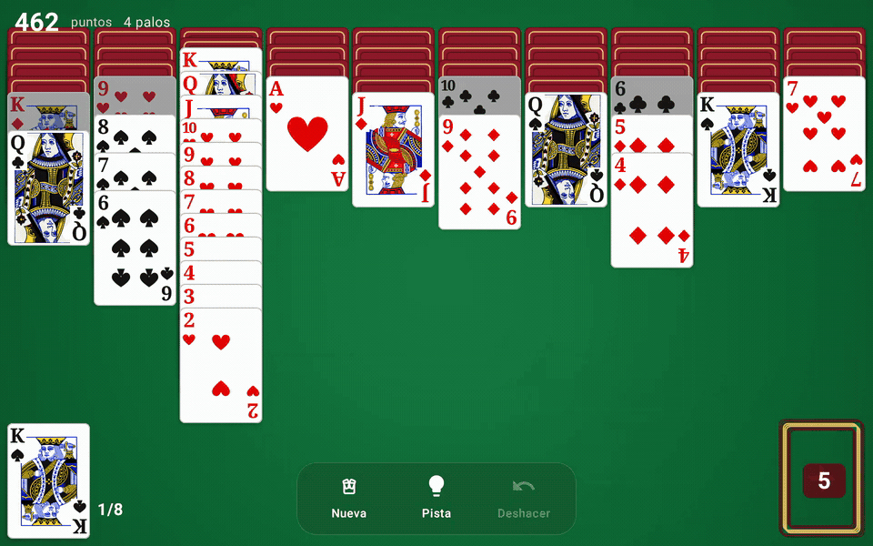

# Spider Solitaire

Spider Solitaire for Android tablets. Landscape, no ads, no purchases, no network.



An ace is not dragged onto a pile. It closes a same-suit run from king to ace, and the run leaves on its own. [Video](docs/table.mp4).


## Rules

104 cards and 10 columns. The first four columns start with 6 cards, the rest with 5. Only the top card is face up. The stock holds 50 cards: five deals of 10.

- Move a face-up descending run of one suit.
- Drop it on any suit of the next rank up, or on an empty column.
- An ace goes on a 2. Nothing goes on an ace.
- K Q J 10 9 8 7 6 5 4 3 2 A of one suit, on top of a column, is removed on its own. Complete 8 of them.
- You cannot deal while a column is empty.
- Scoring starts at 500. Each move or deal costs 1. Each completed suit scores 100. Undo restores the whole game, including the score.
- With an empty stock and every card face up, the game finishes itself using same-suit moves only.

1 suit is all spades. 2 suits are spades and hearts. 4 suits are two full decks.

## Project

```
game/   rules, save format, and tests. Plain Kotlin, no Android
app/    Jetpack Compose table, on-disk game, icon
```

| | |
| --- | --- |
| Language | Kotlin 2.0, Java 17 |
| UI | Jetpack Compose. Cards are drawn on a `Canvas`, not bitmaps |
| Minimum | Android 8 (API 26), compiled with SDK 35 |
| Package | `com.mun0n.spider` |
| Tests | JUnit, in `:game` |

Animations commit the move before showing it. An `Animatable` from 0 to 1 interpolates copies of the cards above the felt: the deal, a slide, and a completed suit leaving. A drag follows the finger; if the drop is illegal, the cards go back.

The game is stored in `filesDir/spider_save.txt`. The format is text (`SaveCodec`): the current game and the undo history.

## Build

JDK 17 and Android SDK 35. `local.properties` with `sdk.dir` is not in the repo; Android Studio creates it when you open the project.

```bash
./gradlew :game:test
./gradlew :app:assembleDebug
```

The APK is at `app/build/outputs/apk/debug/`.

## Release

Signing is applied only when `keystore.properties` exists. That file and the `.jks` are gitignored.

```bash
cp keystore.properties.example keystore.properties
keytool -genkeypair -keystore spider-release.jks -alias spider \
  -keyalg RSA -keysize 2048 -validity 10000
```

Fill in both passwords in `keystore.properties`, then:

```bash
./gradlew :app:assembleRelease
```

Without that file the release APK is unsigned, and the rest of the project still builds.

## What it does not have

No `INTERNET` permission, no ads, no purchases, and no daily challenges. The interface is in Spanish. The activity is locked to landscape (`sensorLandscape`).

## License

[MIT](LICENSE). You can use, modify, and redistribute it, including in a closed project, as long as the copyright notice stays.
