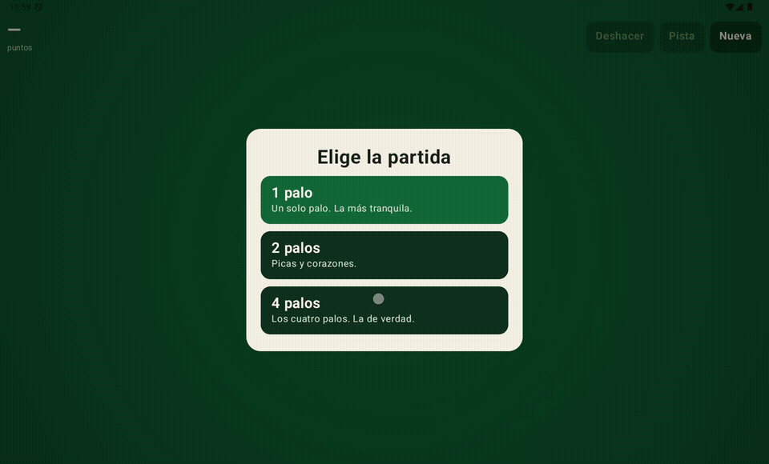
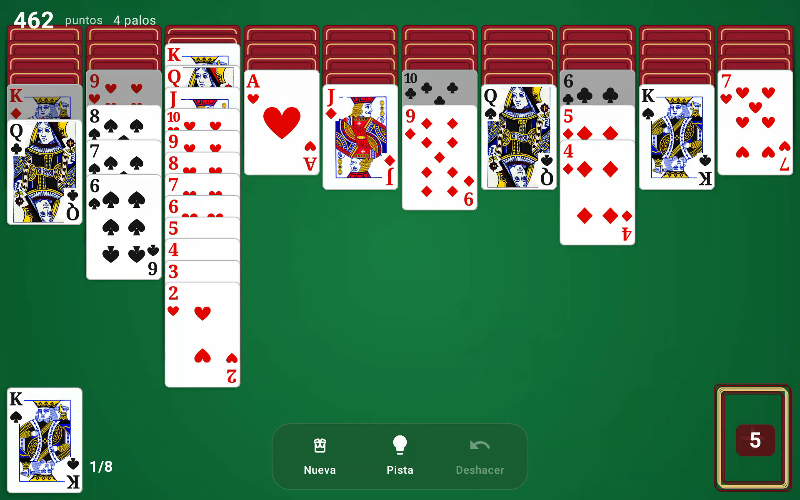
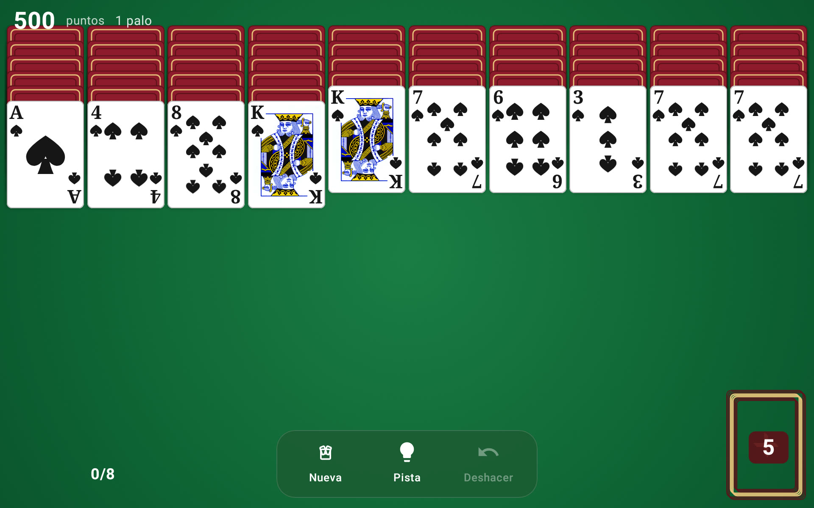

# Spider Solitaire

Solitario Spider para tablet Android. Apaisado, sin anuncios, sin compras y sin red.



El as no se arrastra a un montón: cierra una escalera del mismo palo, del rey al as, y entonces sale solo. [Vídeo](docs/spider-solitaire.mp4).



Partida a 4 palos. El as no se arrastra a un montón: cierra una escalera del mismo palo, del rey al as, y entonces sale solo.



## Reglas

104 cartas y 10 columnas. Las cuatro primeras salen con 6 cartas y el resto con 5. Solo la de arriba está boca arriba. En el mazo quedan 50, cinco repartos de 10.

- Se mueve una escalera boca arriba, del mismo palo y descendente.
- Se suelta sobre cualquier palo del rango justo superior, o sobre una columna vacía.
- El as va encima de un 2. Encima del as no va nada.
- K Q J 10 9 8 7 6 5 4 3 2 A del mismo palo, arriba de una columna, se retira solo. Hay que completar 8.
- No se reparte con una columna vacía.
- Puntuación: se empieza en 500, cada movimiento o reparto resta 1, cada palo suma 100. Deshacer devuelve la partida entera, puntos incluidos.
- Sin mazo y con todas las cartas boca arriba, la partida se termina sola usando solo movimientos del mismo palo.

1 palo es todo picas. 2 palos son picas y corazones. 4 palos son dos barajas completas.

## Proyecto

```
game/   reglas, guardado y tests. Kotlin puro, sin Android
app/    mesa en Jetpack Compose, partida en disco, icono
```

| | |
| --- | --- |
| Lenguaje | Kotlin 2.0, Java 17 |
| UI | Jetpack Compose. Las cartas se dibujan en `Canvas`, no son bitmaps |
| Mínimo | Android 8 (API 26), compilado con SDK 35 |
| Paquete | `com.mun0n.spider` |
| Tests | JUnit, en `:game` |

Las animaciones confirman el movimiento antes de mostrarlo. Un `Animatable` de 0 a 1 interpola copias de las cartas por encima del tapete: reparto, desplazamiento y salida del palo. El arrastre sigue el dedo; si el destino no vale, la carta vuelve.

La partida se guarda en `filesDir/spider_save.txt`. El formato es texto (`SaveCodec`), con la partida actual y el historial de deshacer.

## Compilar

Hace falta JDK 17 y el Android SDK 35. `local.properties` con `sdk.dir` no está en el repositorio; Android Studio lo crea al abrir el proyecto.

```bash
./gradlew :game:test
./gradlew :app:assembleDebug
```

El APK queda en `app/build/outputs/apk/debug/`.

## Release

La firma solo entra si existe `keystore.properties`. Ese archivo y el `.jks` se ignoran en git.

```bash
cp keystore.properties.example keystore.properties
keytool -genkeypair -keystore spider-release.jks -alias spider \
  -keyalg RSA -keysize 2048 -validity 10000
```

Rellena las dos contraseñas en `keystore.properties` y:

```bash
./gradlew :app:assembleRelease
```

Sin ese archivo el release sale sin firmar y el resto del proyecto compila igual.

## Qué no tiene

Sin permiso `INTERNET`, sin anuncios, sin compras y sin retos diarios. La interfaz está en español. La actividad está fijada en horizontal (`sensorLandscape`).

## Licencia

[MIT](LICENSE). Se puede usar, modificar y redistribuir, también en un proyecto cerrado, conservando el aviso de copyright.
